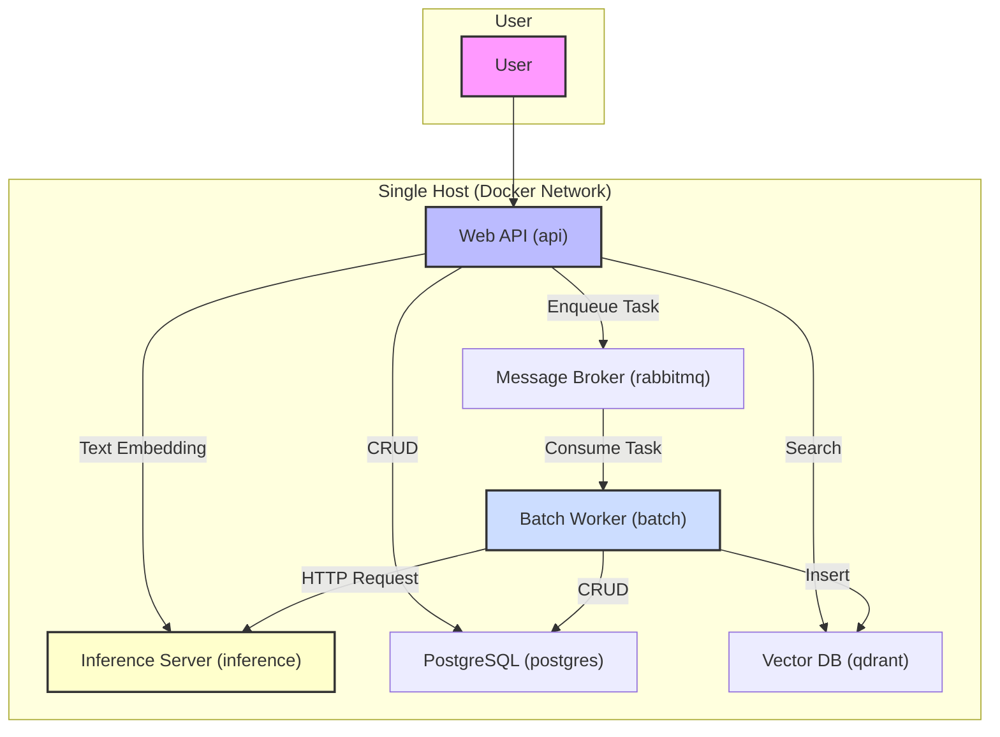

# Lainbow

Lainbow is a music analysis engine designed to process local music libraries. It offers batch processing capabilities to extract deep learning embeddings (MERT, CLAP, MuQ, MuQ-MuLan) and various acoustic features from audio files. These features are then stored in a vector database to power an API for tasks like similarity-based music recommendations and natural language search.

The project is primarily intended for integration with the MPD client, [Sola MPD](https://github.com/prokosna/sola_mpd).

## Architecture Overview

Lainbow is built on a microservices architecture, with each component containerized using Docker. By default, all services run on a single host and communicate over an internal Docker network using service names:

- **Web API Server (`api`)**: The main entry point for user requests. It handles API calls, interacts with the databases, delegates heavy tasks to the batch server, and queries the inference server for text search embeddings.
- **Inference Server (`inference`)**: A dedicated service that hosts deep learning models and performs inference tasks (generating audio and text embeddings).
- **Batch Server (`batch`)**: A Celery worker that processes long-running asynchronous tasks, such as scanning the music library and analyzing songs.
- **Databases**:
    - **PostgreSQL (`postgres`)**: Stores song metadata, acoustic features, and task statuses.
    - **Qdrant (`qdrant`)**: Vector database for storing and querying high-dimensional embeddings.
    - **RabbitMQ (`rabbitmq`)**: Message broker that facilitates communication between the Web API and the Batch Server.



## Quick start

### Prerequisites

- Docker Engine with Docker Compose v2.20 or newer.
- For GPU acceleration:
  - **NVIDIA**: NVIDIA driver and [NVIDIA Container Toolkit](https://docs.nvidia.com/datacenter/cloud-native/container-toolkit/latest/install-guide.html).
  - **AMD**: Host driver and `/dev/kfd` device access (user in `render` or `video` group).

### Getting Started

Run the following commands:

```bash
git clone --branch vX.Y.Z https://github.com/prokosna/lainbow && cd lainbow
./lainbow setup
./lainbow up
./lainbow scan
./lainbow analyze
```

- `git clone --branch vX.Y.Z ...`: Clones a release tag. This is the recommended way to run Lainbow: `./lainbow setup` detects the release tag, sets `LAINBOW_VERSION`, and uses prebuilt container images from GitHub Container Registry (GHCR) so no local image build is required. (To build locally from the latest development code instead, clone `main` without `--branch`.)
- `./lainbow setup`: Detects your hardware, prompts for configuration (music directory, accelerator, models, ports), writes `.env`, and downloads the required deep learning models inside an inference container.
- `./lainbow up`: Starts the container stack in the background with Docker Compose and waits until all service healthchecks report healthy. (Pulls prebuilt images from GHCR if on a release tag, or starts local builds.)
- `./lainbow scan`: Scans your music library directory and inserts song metadata into PostgreSQL.
- `./lainbow analyze`: Extracts audio features and vector embeddings for all songs and indexes them in Qdrant.

## Hardware

| Accelerator | Requirements | Inference Image Size | Performance & Features |
|---|---|---|---|
| **CPU** | Docker and Compose v2.20+ (no GPU drivers needed) | ~1.7 GB | Same features, slower |
| **NVIDIA** | NVIDIA GPU, NVIDIA driver, NVIDIA Container Toolkit (CUDA 12.8 wheels) | ~7.9 GB | Fast GPU-accelerated inference |
| **AMD** | ROCm-compatible AMD GPU, host driver, `/dev/kfd` access (ROCm 6.4 wheels) | ~16 GB | Fast GPU-accelerated inference |

- Accelerator selection is handled automatically by `./lainbow setup` (or via `--accel cpu|cuda|rocm`); no Dockerfile editing is required.
- Default analysis models are `muq` (song-to-song similarity) and `muq_mulan` (natural language text search) on every accelerator; CPU has the same features and is only slower.
- CLAP and MERT are optional models that can be added during setup or analysis.
- Downloading MuQ-MuLan model weights takes approximately 15 minutes depending on your internet connection.
- Run `./lainbow doctor` at any time to verify system requirements, GPU visibility, port availability, and disk space.

## Connecting Sola MPD

Configure [Sola MPD](https://github.com/prokosna/sola_mpd) to connect to Lainbow:

- **API URL**: Set the advanced search API endpoint to `http://<host>:<WEB_API_PORT>` (default: `http://localhost:8000`).
- **Music directory match**: `MUSIC_NAS_ROOT_DIR` in `.env` must point to the exact same folder as MPD's `music_directory`. Song paths in the database and vector index are stored relative to this directory. If they differ, similar-song lookups and song analysis requests will fail with 404 Not Found.

## Everyday commands

Use the `./lainbow` CLI for common operations:

| Subcommand | Description |
|---|---|
| `./lainbow setup` | Set up `.env` configuration and download models (`--yes`, `--music-dir`, `--accel`, `--models`, `--api-port`, `--data-dir`). |
| `./lainbow up` | Start services with Docker Compose and wait for healthchecks to pass. |
| `./lainbow down` | Stop running services. |
| `./lainbow status` | Show container status, Web API health (`/health`), and database statistics (`/api/v1/stats`). |
| `./lainbow logs [svc]` | Follow container logs (optionally for a specific service such as `api` or `batch`). |
| `./lainbow scan` | Start a music library scan task and wait for completion. |
| `./lainbow vacuum` | Start a library vacuum task to purge deleted songs and wait for completion. |
| `./lainbow analyze` | Start song analysis task and wait for completion (`--models a,b`, `--retry-failed`). |
| `./lainbow update` | Update and restart services (prebuilt: pulls images; local: git pull and rebuilds). |
| `./lainbow doctor` | Diagnose Docker version, GPU visibility, published ports, and free disk space. |
| `./lainbow help` | Display usage information and subcommand options. |

### Updating

Running `./lainbow update` updates and restarts services based on your installation mode:

- **Prebuilt mode (`LAINBOW_VERSION` set to a release tag)**: Pulls updated container images from GHCR (`compose pull`) and restarts services without building (`up -d --no-build`).
- **Local build mode (`main` branch, `LAINBOW_VERSION=local`)**: Runs `git pull --ff-only`, rebuilds containers (`compose build`), and restarts services.

## Configuration

Lainbow configuration is managed via a single `.env` file in the project root. `./lainbow setup` generates this file with secure random database passwords and settings tailored to your hardware.

### Compose Profiles

The `COMPOSE_PROFILES` variable controls which services Docker Compose runs:

- `db`: PostgreSQL (`postgres`), RabbitMQ (`rabbitmq`), and Qdrant (`qdrant`) datastores.
- `app`: Web API (`api`) and Celery batch worker (`batch`).
- `inference-cpu`: CPU inference service.
- `inference-cuda`: NVIDIA CUDA inference service.
- `inference-rocm`: AMD ROCm inference service.
- `debug`: Optional Flower dashboard for monitoring Celery queues (port 5555).

For a single-host setup, use `COMPOSE_PROFILES=db,app,inference-cpu` (or substitute `inference-cuda` / `inference-rocm`).

### Key Variables

| Variable | Description | Default |
|---|---|---|
| `COMPOSE_PROFILES` | Active Compose profiles to launch on this host. | `db,app,inference-cpu` |
| `MUSIC_NAS_ROOT_DIR` | Absolute path to the music library on the host. | *(Set during setup)* |
| `DATABASE_DATA_ROOT_DIR` | Host root directory for `postgres_data`, `rabbitmq_data`, and `qdrant_data`. | `.` |
| `WEB_API_PORT` | Host port exposed for the Web API (bound to `0.0.0.0`). | `8000` |
| `POSTGRES_PASSWORD` | Password for PostgreSQL user. | *(Generated randomly)* |
| `RABBITMQ_DEFAULT_PASS` | Password for RabbitMQ default user. | *(Generated randomly)* |
| `LAINBOW_ANALYZE_MODELS` | Default models analyzed when running `./lainbow analyze`. | `muq,muq_mulan` |
| `LAINBOW_BIND_ADDRESS` | Host IP address to bind internal datastore and inference ports. | `127.0.0.1` |
| `LAINBOW_GPU_GID` | Numeric group ID for `/dev/kfd` device permissions on ROCm hosts. | `video` |

For additional tuning options (such as `TASK_CHUNK_SIZE`, `INFERENCE_REQUEST_TIMEOUT`, `TASK_STALE_AFTER_SEC`, `BATCH_CONCURRENCY`, `MUQ_FILE_DURATION_SEC`, and `INFERENCE_MODEL_MANAGER_MODE`), see [.env.template](.env.template).

## Running on several machines

To distribute Lainbow across multiple hosts:

1. **Host Roles and Profiles**:
   - **Database Host**: Runs profile `COMPOSE_PROFILES=db` (`postgres`, `rabbitmq`, `qdrant`).
   - **App Host**: Runs profile `COMPOSE_PROFILES=app` (`api`, `batch`).
   - **Inference Host** (if separated from App): Runs profile `COMPOSE_PROFILES=inference-cuda` (or `inference-rocm`, `inference-cpu`).

2. **App Host Configuration (`.env`)**:
   Point the app and worker containers to the remote services:
   - `POSTGRES_HOST`: Hostname or IP of the database server (default: `postgres`).
   - `POSTGRES_CONNECT_PORT`: Port of the PostgreSQL service (default: `5432`).
   - `RABBITMQ_HOST`: Hostname or IP of the RabbitMQ server (default: `rabbitmq`).
   - `RABBITMQ_CONNECT_PORT`: Port of the RabbitMQ service (default: `5672`).
   - `QDRANT_HOST`: Hostname or IP of the Qdrant server (default: `qdrant`).
   - `QDRANT_CONNECT_PORT`: Port of the Qdrant service (default: `6333`).
   - `INFERENCE_API_URL`: Full HTTP URL of the inference server (e.g. `http://<inference-host>:8001`).

3. **Database Host Configuration (`.env`)**:
   - Set `LAINBOW_BIND_ADDRESS=0.0.0.0` so that datastore ports (`POSTGRES_PORT`, `RABBITMQ_PORT`, `QDRANT_PORT_HTTP`, `QDRANT_PORT_GRPC`) listen on external network interfaces.
   - > [!WARNING]
     > Setting `LAINBOW_BIND_ADDRESS=0.0.0.0` exposes PostgreSQL, RabbitMQ, and Qdrant to the network. Ensure your firewall or network access controls restrict access to authorized hosts only.

## Upgrading from the old layout (docker-compose.*.yaml)

If upgrading an existing deployment that used separate `docker-compose.*.yaml` files:

1. **Stop the old stack before pulling updates**:
   Before running `git pull`, stop the existing containers using the old compose files (these files will be removed in the update):
   ```bash
   docker compose -f docker-compose.api.yaml down
   docker compose -f docker-compose.batch.yaml down
   docker compose -f docker-compose.inference.yaml --profile cpu --profile cuda --profile rocm down
   docker compose -f docker-compose.database.yaml down
   ```
   *(The inference services are behind profiles, so `down` only stops them when their profile is named.)*

   > [!TIP]
   > If you already pulled the latest commits and the old compose files are no longer on disk, you can recover a compose file from Git history to stop running containers:
   > ```bash
   > git show 600efa1:docker-compose.database.yaml > /tmp/old-db.yaml
   > docker compose -f /tmp/old-db.yaml down
   > ```
   > (You can similarly extract `docker-compose.api.yaml`, `docker-compose.batch.yaml`, or `docker-compose.inference.yaml` if needed.)

2. **Pull the latest code**:
   ```bash
   git fetch --tags
   git checkout vX.Y.Z  # recommended (prebuilt images), or git pull on main (local build)
   ```

3. **Run `./lainbow setup`**:
   `./lainbow setup` inspects your existing `.env`, keeps every existing configuration line, creates a timestamped backup (`.env.bak.<timestamp>`), and appends the new keys. It automatically configures `POSTGRES_PASSWORD=password` and `RABBITMQ_DEFAULT_PASS=password` because existing database volumes were created with those legacy default credentials.

4. **Start the new stack**:
   ```bash
   ./lainbow up
   ```
   The data directories under `DATABASE_DATA_ROOT_DIR` (`postgres_data`, `rabbitmq_data`, `qdrant_data`) and the `models/` directory are reused as they are. The Web API container automatically upgrades the database schema on start via Alembic migrations (no data is altered except renaming one column, `milvus_collection_name` to `vector_collection_name`).

## Migrating from Milvus to Qdrant (Optional)
If you already have embeddings stored in Milvus and want to migrate them to Qdrant:

1. Start Qdrant and your existing Milvus deployment on the database server. The Milvus services were removed from this repository's compose file; use `docker-compose.database.yaml` from commit `600efa1` or earlier to start them.
2. Run the migration script:
   ```bash
   uv run --with pymilvus --with qdrant-client tools/migrate_milvus_to_qdrant.py
   ```

After the migration finishes, you can disable Milvus again and keep using Qdrant.

## Development

Set up a local development environment:

```bash
uv sync --group dev --group api --group batch --group inference --group inference-cpu
```

Run automated quality checks and tests:

```bash
scripts/check.sh
```

`scripts/check.sh` runs `ruff check`, `ruff format --check`, `mypy`, `pytest`, and `shellcheck`.

Start the development stack with live reloading:

```bash
docker compose -p lainbow-dev -f compose.yaml -f compose.dev.yaml up
```

`compose.dev.yaml` binds the `src/` directory into containers and enables Uvicorn reload for fast iteration.

For coding conventions, agent protocols, and project invariants, see [AGENTS.md](AGENTS.md).

## API Endpoints

### General

#### `GET /health`
- **Summary**: Health check endpoint.
- **Response (200 OK)**: `{"status":"ok"}`

### Statistics

#### `GET /api/v1/stats`
- **Summary**: Get database statistics.
- **Description**: Retrieve statistics about the current state of the database, including song counts and task statuses.
- **Response (200 OK)**:
  ```json
  {
    "total_songs": 1000,
    "songs_with_acoustic_features": 50,
    "songs_with_clap": 100,
    "songs_with_mert": 100,
    "songs_with_muq": 200,
    "songs_with_muq_mulan": 200,
    "pending_tasks": 5,
    "running_tasks": 2
  }
  ```

### Batch Processing

#### `POST /api/v1/batch/scan/run`
- **Summary**: Start a music library scan.
- **Description**: Triggers a background task to scan the music library path specified in `.env`.
- **Response (200 OK)**: Returns a `TaskResult` object.
  ```json
  {
    "id": "...",
    "name": "scan",
    "status": "PENDING",
    "result": null
  }
  ```

#### `POST /api/v1/batch/vacuum/run`
- **Summary**: Run library vacuum.
- **Description**: Triggers a background task to remove database entries for songs that no longer exist on disk.
- **Response (200 OK)**: Returns a `TaskResult` object.

#### `POST /api/v1/batch/analyze/run`
- **Summary**: Run song analysis.
- **Description**: Enqueues a task to analyze all songs and generate embeddings for the specified models.
- **Request Body** (optional):
  ```json
  {
    "models": ["muq", "muq_mulan"],
    "retry_failed": false
  }
  ```
  *If the body is omitted, `models` defaults to `LAINBOW_ANALYZE_MODELS` (`["muq", "muq_mulan"]`) and `retry_failed` defaults to `false`.*
- **Response (200 OK)**: Returns a `TaskResult` object.

#### `GET /api/v1/batch/tasks/{task_id}`
- **Summary**: Get task status.
- **Description**: Retrieves the current status and result of a specific background task.
- **Path Parameters**:
  - `task_id` (UUID, required): The ID of the task.
- **Response (200 OK)**: Returns a `TaskResult` object with the current status.

### Songs

#### `GET /api/v1/songs/search`
- **Summary**: Search songs by natural language.
- **Description**: Searches for songs based on a natural language query, e.g., "a song for a summer evening".
- **Query Parameters**:
  - `q` (string, required): Natural language query.
  - `model_name` (string, optional, default: `muq_mulan`): The text embedding model to use. Can be `clap` or `muq_mulan`.
  - `limit` (integer, optional, default: 10): Maximum number of results.
- **Responses**:
  - **200 OK**: Returns a `SearchSongResult` object with matching songs.
  - **503 Service Unavailable**: Returned when the inference server is unreachable or times out.

#### `GET /api/v1/songs/{file_path}/analysis`
- **Summary**: Get detailed song analysis.
- **Description**: Retrieves detailed analysis for a given song, including metadata, features, and embedding status.
- **Path Parameters**:
  - `file_path` (string, required): The URL-encoded file path of the song.
- **Response (200 OK)**: Returns a `SongAnalysis` object.

#### `GET /api/v1/songs/{file_path}/similar`
- **Summary**: Find similar songs.
- **Description**: Finds songs acoustically similar to the given song using a specified vector embedding model.
- **Path Parameters**:
  - `file_path` (string, required): The URL-encoded file path of the song.
- **Query Parameters**:
  - `model_name` (string, optional, default: `muq`): The embedding model to use. Can be `acoustic_features`, `clap`, `mert`, `muq`, `muq_mulan`.
  - `limit` (integer, optional, default: 10): Maximum number of results.
- **Response (200 OK)**: Returns a list of `SearchSong` objects.
